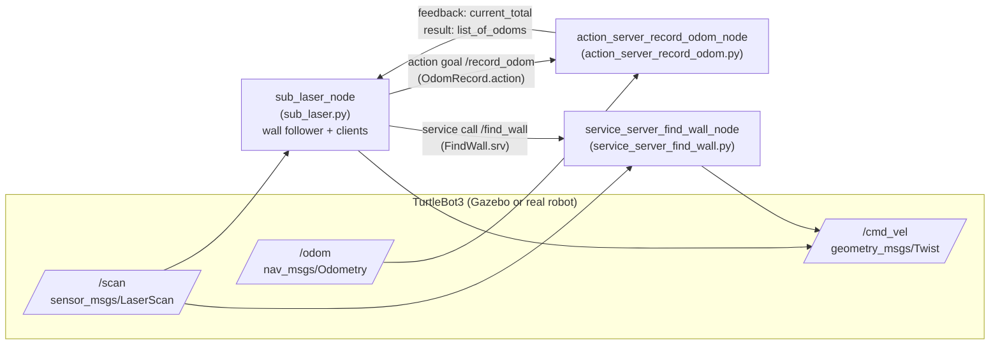
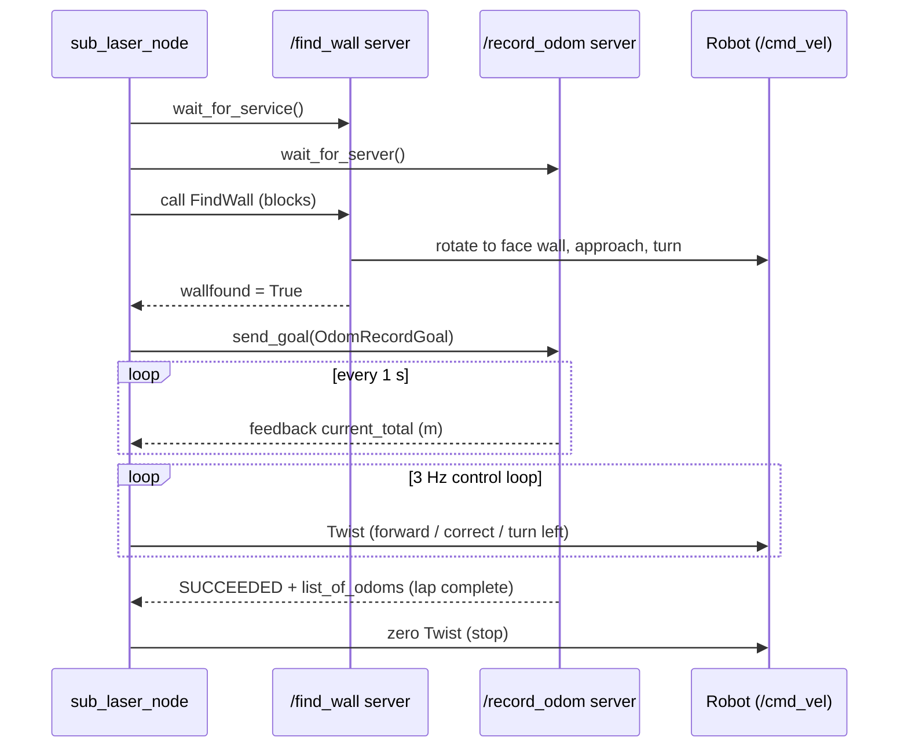

# ROS Robotics Car: Autonomous Wall Following on TurtleBot3

-22314E?logo=ros)


This is the course project for **ROS Basics in 5 Days** (The Construct). It is a ROS 1 package
that makes a **TurtleBot3** robot do three things on its own:

1. **Find the nearest wall** and line up next to it (a ROS **service**).
2. **Follow the wall** with the wall on its right, about 0.2–0.3 m away (ROS **topics**).
3. **Record its odometry** while it drives, report the distance travelled so far, and **stop after one
   full lap** (a ROS **action**).

The code was developed and tested in the Gazebo simulation first. It was then run on the real TurtleBot3
in The Construct's *Real Robot Lab* in Barcelona, Spain, which you connect to remotely.

---

## Table of Contents

- [Demo Behaviour](#demo-behaviour)
- [How It Maps to the Course](#how-it-maps-to-the-course)
- [System Architecture](#system-architecture)
- [Package Structure](#package-structure)
- [ROS Interfaces](#ros-interfaces)
- [How It Works](#how-it-works)
  - [Laser Scan Conventions](#laser-scan-conventions)
  - [1. Find-Wall Service Server](#1-find-wall-service-server)
  - [2. Wall-Following Node](#2-wall-following-node)
  - [3. Odometry-Recording Action Server](#3-odometry-recording-action-server)
- [Installation](#installation)
- [Usage](#usage)
- [Testing Each Component Separately](#testing-each-component-separately)
- [Tuning Parameters](#tuning-parameters)
- [From Simulation to the Real Robot](#from-simulation-to-the-real-robot)
- [Known Limitations and Future Work](#known-limitations-and-future-work)
- [Acknowledgements](#acknowledgements)
- [License](#license)

---

## Demo Behaviour

When you run `roslaunch ros_project main.launch`, the robot goes through these steps:

```
 ┌──────────────┐    ┌────────────────┐    ┌──────────────┐    ┌────────────────┐    ┌──────────┐
 │ Find nearest │ -> │ Drive to wall  │ -> │ Turn so wall │ -> │ Follow wall +  │ -> │ Lap done │
 │ wall (laser) │    │ (front < 0.3m) │    │ is on right  │    │ record odom    │    │  -> STOP │
 └──────────────┘    └────────────────┘    └──────────────┘    └────────────────┘    └──────────┘
   /find_wall service (blocking call)                            /record_odom action (feedback = metres)
```

---

## How It Maps to the Course

| Course section | ROS concept | Implementation in this repo |
|---|---|---|
| **Section 1** – Topics | Publisher / Subscriber | `scripts/sub_laser.py` subscribes to `/scan` and publishes to `/cmd_vel` to follow the wall |
| **Section 2** – Services | Service server / client | `scripts/service_server_find_wall.py` provides `/find_wall` (`FindWall.srv`). The wall follower calls it before its control loop starts |
| **Section 3** – Actions | Action server / client | `scripts/action_server_record_odom.py` provides `/record_odom` (`OdomRecord.action`). The wall follower sends it a goal before it starts following the wall |
| Launch | `roslaunch` | `launch/main.launch` starts all three nodes |

---

## System Architecture



The order of calls at startup:



Only one node publishes to `/cmd_vel` at any time. The `/find_wall` call is **synchronous**, so the wall
follower does not start its control loop until the service server has finished moving the robot and
returned.

---

## Package Structure

The repository root **is** the catkin package. Its name in `package.xml` is **`ros_project`**.

```
ROS_Robotics_Car/                       # catkin package "ros_project"
├── CMakeLists.txt                      # builds the .srv and .action interfaces
├── package.xml                         # package manifest & dependencies
├── srv/
│   └── FindWall.srv                    # empty request -> bool wallfound
├── action/
│   └── OdomRecord.action               # empty goal -> Point32[] result, float32 feedback
├── scripts/
│   ├── service_server_find_wall.py     # Section 2: /find_wall service server
│   ├── action_server_record_odom.py    # Section 3: /record_odom action server
│   └── sub_laser.py                    # Section 1: wall follower (+ service & action clients)
└── launch/
    ├── main.launch                     # full project: service + action server + wall follower
    ├── sub_laser.launch                # wall follower only
    └── service_server_find_wall.launch # wall follower + find-wall server (Section 2 stage)
```

---

## ROS Interfaces

### Topics

| Topic | Type | Direction | Used by |
|---|---|---|---|
| `/scan` | `sensor_msgs/LaserScan` | subscribed | wall follower, find-wall server |
| `/cmd_vel` | `geometry_msgs/Twist` | published | wall follower, find-wall server |
| `/odom` | `nav_msgs/Odometry` | subscribed | odometry action server |

### Service: `/find_wall`

`srv/FindWall.srv`

```
# request (empty)
---
bool wallfound
```

### Action: `/record_odom`

`action/OdomRecord.action`

```
# goal (empty)
---
# result
geometry_msgs/Point32[] list_of_odoms   # x, y = position (m), z = yaw theta (rad)
---
# feedback
float32 current_total                   # distance travelled so far (m)
```

> **Note:** `Point32` has no field named for heading, so the **`z` field stores the yaw angle θ**
> (taken from the odometry quaternion with `tf.transformations.euler_from_quaternion`).

---

## How It Works

### Laser Scan Conventions

All three nodes read the laser by **array index**. The code assumes a 720-sample scan where index 0
points backwards, so `angle_min ≈ -π` and `angle_increment ≈ 0.5°`:

| Direction | Index in `ranges[]` | Angle (from front, CCW +) |
|---|---|---|
| Back  | `0`   | ±180° |
| Right | `180` | −90° |
| Front-right | `270` | −45° |
| **Front** | **`360`** | **0°** |
| Left  | `540` | +90° |

A ray's angle is `ray_angle = angle_min + i * angle_increment`. The find-wall server uses this formula to
work out how far it has to turn.

### 1. Find-Wall Service Server

`scripts/service_server_find_wall.py` (node `service_server_find_wall_node`)

When `/find_wall` is called, the server:

1. **Waits for a laser scan.** It blocks until it receives the first `/scan` message.
2. **Finds the shortest ray.** It takes `ranges.index(min(ranges))` and assumes that ray points at the
   nearest wall.
3. **Rotates to face the wall.** It converts the ray index to an angle and turns at ±0.3 rad/s for
   `|ray_angle| / 0.3` seconds. It turns left if the angle is positive and right if it is negative. This
   is a time-based (open-loop) turn.
4. **Drives towards the wall** at 0.08 m/s until the front ray (`ranges[360]`) reads **less than 0.3 m**.
   This step is closed-loop on the laser.
5. **Turns to put the wall on its right.** It rotates left by the angle of ray **270** (|−45°|). After this
   turn, ray 270 (front-right) points at the wall. The wall follower's "front < 0.5 m → turn left" rule
   then finishes lining the robot up along the wall.
6. **Stops the robot** and returns `wallfound = True`.

The server's internal loop runs at 3 Hz (`rospy.Rate(3)`).

### 2. Wall-Following Node

`scripts/sub_laser.py` (node `sub_laser_node`)

At startup the node:

1. Waits for the `/find_wall` service **and** the `/record_odom` action server.
2. Calls `/find_wall` and blocks until the robot is lined up with the wall.
3. If the call returns `True`, it sends an empty goal to `/record_odom`. The feedback is printed to the
   console.
4. It then starts the control loop.

The **control loop runs at 3 Hz**. On every loop it reads the front ray (`ranges[360]`) and the right ray
(`ranges[180]`) and checks these rules in order:

| Priority | Condition | Action | `linear.x` | `angular.z` |
|---|---|---|---|---|
| 1 | `front <= 0.5 m` | Wall ahead: **turn left fast** onto the next wall | 0.08 | +0.5 |
| 2 | `right >= 0.3 m` | Too far from the wall: **steer right** | 0.08 | −0.1 |
| 3 | `right <= 0.2 m` | Too close to the wall: **steer left** | 0.08 | +0.2 |
| 4 | otherwise (0.2–0.3 m) | In the band: **go straight** | 0.08 | 0.0 |

The front-wall rule is checked first, so at corners the robot hands over smoothly from the current wall
to the next one. It does this by turning left while still moving forward, as the project specification
recommends.

On every loop the node also checks the action's state. When the state becomes **`SUCCEEDED`** (one lap is
done), the node logs the recorded odometry list, publishes a zero `Twist` 5 times so the stop is
received, and exits the loop.

`publish_once_in_cmd_vel()` waits until `/cmd_vel` has at least one subscriber before it publishes, so no
command is lost during startup.

### 3. Odometry-Recording Action Server

`scripts/action_server_record_odom.py` (node `action_server_record_odom_node`)

- Subscribes to `/odom` and keeps the latest `(x, y, θ)` in memory. θ is the yaw from the quaternion.
- When it receives a goal, it stores the starting position. Then, **once per second** (`rospy.Rate(1)`), it:
  1. adds a `Point32(x, y, θ)` to the record list,
  2. adds the straight-line distance since the last sample to `total_distance`,
  3. **publishes feedback** `current_total = total_distance`,
  4. checks whether the lap is complete:

     ```
     total_distance > 0.5 m   AND   distance_to_start < 0.1 m
     ```

     When both are true, it returns the full `list_of_odoms` as the result and marks the goal as
     **succeeded**.

The `total_distance > 0.5 m` check stops the lap from counting as complete at the very start, when the
robot has not moved yet. Because the robot drives at 0.08 m/s and samples are taken at 1 Hz, it moves
about 0.08 m between samples. That is less than the 0.1 m tolerance, so the robot cannot pass the start
point between two samples without one of them landing inside the tolerance (assuming it comes back along
the same line it started on).

---

## Installation

### Prerequisites

- Ubuntu 20.04 + **ROS Noetic** (ROS 1), with `rospy`, `actionlib`, `tf`, `sensor_msgs`, `nav_msgs`,
  `geometry_msgs`
- A TurtleBot3 simulation or robot that publishes `/scan` and `/odom` and accepts `/cmd_vel`. In The
  Construct rosject, the `realrobotlab` simulation provides this.
- Optional: `teleop_twist_keyboard`, to place the robot by hand, and `actionlib_tools`, for `axclient.py`

### Build

```bash
# 1. Clone into your catkin workspace (the package name is "ros_project")
cd ~/catkin_ws/src
git clone https://github.com/JimCH123/ROS_Robotics_Car.git ros_project

# 2. Make the Python nodes executable (needed by rosrun / roslaunch)
chmod +x ros_project/scripts/*.py

# 3. Build the workspace (this generates FindWall.srv and OdomRecord.action)
cd ~/catkin_ws
catkin_make
source devel/setup.bash
```

> Step 2 is required: the scripts must be executable for `rosrun` / `roslaunch`. If you skip it,
> `roslaunch` fails with *"Cannot locate node of type …"* or *"… is not executable"*.

---

## Usage

### 1. Start the simulation

```bash
# Terminal 1
source /home/user/simulation_ws/devel/setup.bash
roslaunch realrobotlab main.launch
```

Check that it is running with `rostopic list`. You should see `/scan`, `/odom` and `/cmd_vel`.

### 2. Run the whole project

```bash
# Terminal 2
source ~/catkin_ws/devel/setup.bash
roslaunch ros_project main.launch
```

The robot finds the nearest wall, lines up with it, starts recording odometry, follows the wall, and stops
when it has done one lap.

### 3. Watch it work

```bash
# Distance travelled so far (action feedback, every second)
rostopic echo /record_odom/feedback

# Velocity commands being sent to the robot
rostopic echo /cmd_vel
```

You can also open RViz and add the `LaserScan` (`/scan`) and `Odometry` (`/odom`) displays.

---

## Testing Each Component Separately

Following the course method, each part can be checked on its own.

**Find-wall service**

```bash
rosrun ros_project service_server_find_wall.py
# in another terminal
rosservice call /find_wall
# -> wallfound: True
```

**Odometry action server**

```bash
rosrun ros_project action_server_record_odom.py
# in another terminal: send an empty goal and watch the feedback
rosrun actionlib_tools axclient.py /record_odom
```

**Positioning the robot by hand** (close the teleop afterwards, or it will fight with the nodes over
`/cmd_vel`):

```bash
rosrun teleop_twist_keyboard teleop_twist_keyboard.py
```

> **About the other launch files.** `sub_laser.py` waits for **both** `/find_wall` **and** `/record_odom`
> before it does anything. So `sub_laser.launch` and `service_server_find_wall.launch`, which were used at
> the Section 1 and 2 stages, will stay waiting unless the action server is also running. Use
> **`main.launch`** for the complete behaviour.

---

## Tuning Parameters

All values are currently hard-coded as default function arguments.

| Parameter | Value | Location |
|---|---|---|
| Control loop rate | 3 Hz | `sub_laser.py`, `service_server_find_wall.py` |
| Forward speed | 0.08 m/s | `sub_laser.py`, `service_server_find_wall.py` |
| Front-wall turn threshold | 0.5 m | `sub_laser.py` → `move_robot()` |
| Corner turn rate | +0.5 rad/s | `sub_laser.py` → `turning_left()` |
| Desired wall band (right) | 0.2 – 0.3 m | `sub_laser.py` → `move_robot()` |
| Steer-right correction | −0.1 rad/s | `sub_laser.py` → `detect_wall_right()` |
| Steer-left correction | +0.2 rad/s | `sub_laser.py` → `detect_wall_left()` |
| Find-wall rotate speed | ±0.3 rad/s | `service_server_find_wall.py` |
| Find-wall stop distance | 0.3 m | `service_server_find_wall.py` → `moving_to_wall()` |
| Odometry sample rate | 1 Hz | `action_server_record_odom.py` |
| Lap-complete criteria | > 0.5 m travelled & < 0.1 m from start | `action_server_record_odom.py` |

---

## From Simulation to the Real Robot

The project followed the course rule: **"If it doesn't work in simulation, it won't work on the real
robot."**

1. Develop and debug everything in Gazebo first.
2. Book a slot in The Construct **Real Robot Lab** and turn on the robot connection from the rosject.
3. Use the joystick to place the TurtleBot3 near a wall, then run `roslaunch ros_project main.launch`.
4. Retune the speeds and thresholds above to deal with real sensor noise, wheel slip and the
   lab's walls.

Things to keep in mind on the real robot:

- Real lidars can return `inf`/`0.0` for some rays. `min(ranges)` in the find-wall server may pick one of
  these.
- If the real robot's scan has a different layout (number of samples or `angle_min`), the fixed indices
  (180 / 270 / 360) must be changed. You can check the layout with:
  `rostopic echo -n1 /scan | grep -E "angle_min|angle_increment"`.

---

## Known Limitations and Future Work

| Area | Current behaviour | Possible improvement |
|---|---|---|
| Laser indexing | Fixed indices that assume a 720-ray scan | Work out indices from `angle_min` / `angle_increment` at runtime |
| Find-wall rotation | Time-based (open-loop) turns | Closed-loop: turn until the front ray is the minimum, or use odometry yaw |
| Invalid ranges | `inf` / `0.0` readings are not filtered | Ignore values outside `[range_min, range_max]` |
| Wall following | Bang-bang control with fixed turn rates | P/PID controller on the right-side distance error |
| Parameters | Hard-coded | Expose as ROS params (`rospy.get_param`) in the launch file |
| Action server | No preemption/cancel handling; reads `self.x` before the first `/odom` arrives could fail | Check `is_preempt_requested()`; wait for the first odometry message |
| Lap detection | Position-only, 0.1 m radius | Add a heading check and a minimum lap distance based on the arena size |

---

## Acknowledgements

- Project specification and simulation environment: **[The Construct](https://www.theconstruct.ai/)**,
  *ROS Basics in 5 Days* course and the Real Robot Lab (TurtleBot3, Barcelona).
- Robot platform: **ROBOTIS TurtleBot3**.

## Author

**Jim Chen** ([@JimCH123](https://github.com/JimCH123))

## License

This project is released under the [MIT License](LICENSE).
